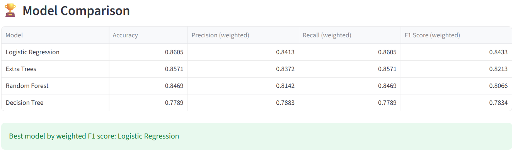
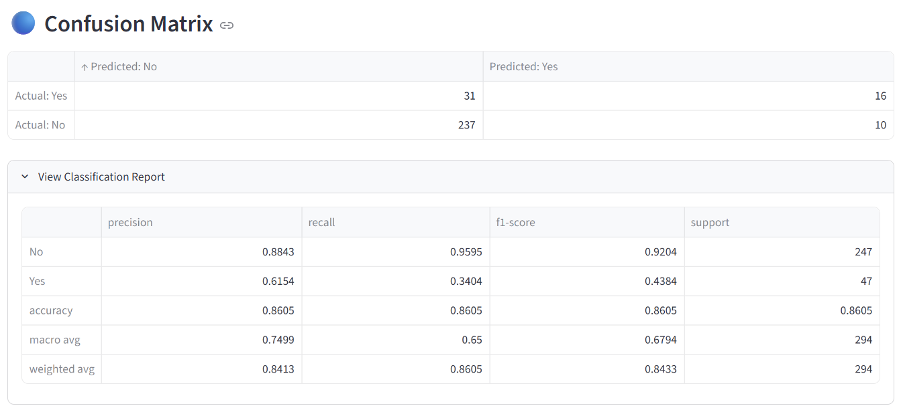
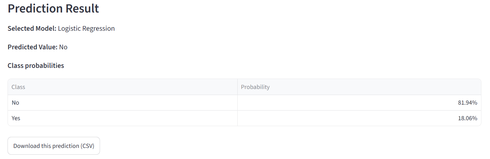

# AutoML Framework 🤖

An interactive **Automated Machine Learning (AutoML) Framework** built with Python and Streamlit. It simplifies the process of training, comparing, and evaluating machine learning models through a user-friendly web interface.

The application supports classification and regression tasks, automatic preprocessing, model comparison, performance visualization, and predictions on new records.

## 🚀 Features

- **Upload your own dataset:** Upload CSV files and train models on your data.
- **Demo dataset:** Explore the framework using the IBM HR Analytics Employee Attrition dataset.
- **Classification and regression:** Choose the appropriate machine learning task.
- **Automatic preprocessing:** Handle numerical and categorical features using preprocessing pipelines.
- **Multiple ML models:** Train and compare several machine learning algorithms.
- **Model evaluation:** View metrics and compare model performance.
- **Visualizations:** Explore evaluation charts, confusion matrices, and classification reports.
- **Predictions:** View test-set predictions and predict outcomes for new records.
- **Download results:** Export predictions and the trained model.
- **Interactive interface:** Configure training through Streamlit.

## 🛠️ Technologies Used

- Python
- Streamlit
- Pandas
- NumPy
- Scikit-learn
- Matplotlib
- Joblib
- Git and GitHub

## 🧠 Machine Learning Algorithms

### Classification
- Logistic Regression
- Decision Tree Classifier
- Random Forest Classifier
- Extra Trees Classifier

### Regression
- Linear Regression
- Decision Tree Regressor
- Random Forest Regressor
- Extra Trees Regressor

## 📊 Model Evaluation

### Classification metrics
- Accuracy
- Weighted precision
- Weighted recall
- Weighted F1-score
- Confusion matrix
- Classification report

### Regression metrics
- Mean Absolute Error (MAE)
- Root Mean Squared Error (RMSE)
- R² score

## 📸 Application Screenshots

### 1. Model Comparison

The framework compares multiple machine learning models and identifies the best-performing model based on the selected evaluation metric.



### 2. Model Evaluation

The confusion matrix and classification report help evaluate model performance across the target classes.



### 3. Prediction Result

The application uses the selected trained model to predict an outcome for a new employee record.



*Note: Model results depend on the dataset, selected target, and train-test split.*

## 📁 Project Structure

```text
AutoML-Framework-implementation/
├── app.py
├── data/
│   └── WA_Fn-UseC_-HR-Employee-Attrition.csv  (local demo data)
├── screenshots/
│   ├── model-comparison.png
│   ├── evaluation.png
│   └── prediction_result.png
├── sample_data.csv
├── requirements.txt
├── README.md
└── .gitignore
```

The IBM HR Analytics dataset is stored locally and excluded from GitHub. Obtain the dataset separately if you want to use the demo dataset.

## ⚙️ Installation and Setup

### 1. Clone the repository

```bash
git clone https://github.com/divyasingh97/AutoML-Framework-implementation.git
```

### 2. Open the project folder

```bash
cd AutoML-Framework-implementation
```

### 3. Create a virtual environment

```bash
python -m venv .venv
```

### 4. Activate the virtual environment

**Windows Git Bash:**

```bash
source .venv/Scripts/activate
```

**Windows Command Prompt:**

```bat
.venv\Scripts\activate
```

### 5. Install dependencies

```bash
python -m pip install -r requirements.txt
```

### 6. Run the application

```bash
python -m streamlit run app.py
```

Open the local URL displayed in your terminal, usually `http://localhost:8501`.

## 📂 How to Use

1. Launch the Streamlit application.
2. Select the dataset source.
3. Upload a CSV file or select the demo dataset.
4. Choose classification or regression.
5. Select the test-data percentage.
6. Choose the target column.
7. Train and compare the available models.
8. Review evaluation metrics and visualizations.
9. Enter new record details to generate a prediction.
10. Download available predictions or the trained model.

**Demo dataset:** The demo uses the IBM HR Analytics Employee Attrition dataset. To use it locally, place `WA_Fn-UseC_-HR-Employee-Attrition.csv` in the `data/` directory. You can also upload a suitable CSV file.

## 🎯 Project Objective

The objective is to make machine learning experimentation more accessible by bringing data input, preprocessing, model training, evaluation, comparison, and prediction into one interactive application.

## 🔮 Future Improvements

- Add more machine learning algorithms.
- Implement automated hyperparameter tuning.
- Add cross-validation for more reliable evaluation.
- Improve handling of missing values and imbalanced datasets.
- Add more evaluation metrics and visualizations.
- Deploy the application online.

## 👩‍💻 Author

**Divya Jadon**  
BCA — Artificial Intelligence and Machine Learning  
Galgotias University

GitHub: [@divyasingh97](https://github.com/divyasingh97)

---

*This project was developed as a practical machine learning application using Python, Scikit-learn, and Streamlit.*